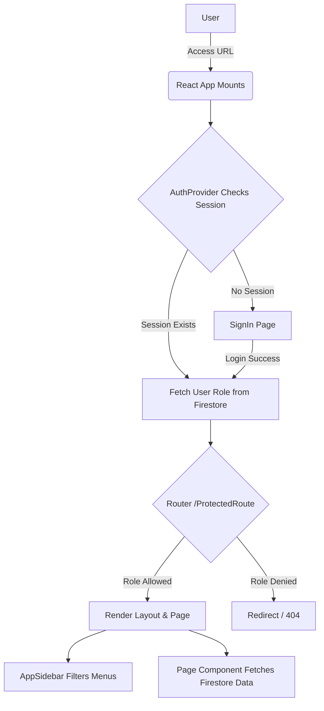
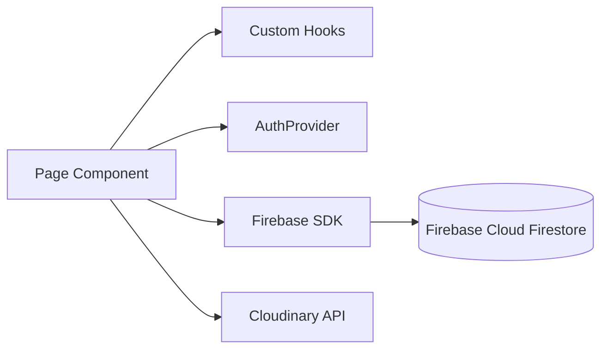

# Bello Live Pro Admin Panel - Technical Documentation

## Table of Contents
1. [Project Overview](#1-project-overview)
2. [Tech Stack](#2-tech-stack)
3. [Folder Structure](#3-folder-structure)
4. [Critical Files & Entry Points](#4-critical-files--entry-points)
5. [Database Structure (Firestore)](#5-database-structure-firestore)
6. [Authentication, Authorization & Security](#6-authentication-authorization--security)
7. [Architecture & Workflow Diagrams](#7-architecture--workflow-diagrams)
8. [Configuration & Integrations](#8-configuration--integrations)
9. [Performance, Bugs & Improvement Opportunities](#9-performance-bugs--improvement-opportunities)
10. [Setup & Deployment Guide](#10-setup--deployment-guide)

---

## 1. Project Overview
**Bello Live Pro Admin Panel** is a React-based frontend web application that serves as the centralized master control interface for the Bello Live mobile application ecosystem. 

**Purpose:** To manage users, agencies, live streaming sessions, virtual gifting, game controls, and application settings.
**Features:**
- Multi-tier Role Management (Mother Panel, Super Admin, Admin, Agency, Reseller).
- Live Audio/Video Room Moderation.
- Virtual Assets Management (Gifts, Emojis, Frames, Room Skins).
- Financial tracking (Coin Management, Reseller Coins).
- Third-party SDK configuration management (Agora SDK).
- Content Management (Banners, About Us, Themes).

---

## 2. Tech Stack
- **Frontend Framework:** React 19 + Vite
- **Routing:** React Router v7
- **Styling:** Tailwind CSS + PostCSS
- **State & Data Management:** React Context API, React Hooks
- **Backend as a Service (BaaS):** Firebase (Firestore, Authentication)
- **Media Uploads:** Cloudinary API
- **UI Components & Icons:** `lucide-react`, `react-icons`, `@fullcalendar`, `react-dropzone`
- **Charts & Visualization:** ApexCharts, React-jvectormap

---

## 3. Folder Structure
```text
MP-Live/
├── public/                 # Static assets (favicons, manifest)
├── src/                    # Main source code directory
│   ├── AuthPage/           # Authentication views (SignIn.tsx)
│   ├── components/         # Reusable UI components (ScrollToTop, Modals)
│   ├── context/            # React context providers (SidebarContext)
│   ├── hooks/              # Custom React hooks
│   ├── icons/              # Custom SVG icon components
│   ├── layout/             # Application layouts (AppLayout, AppSidebar)
│   ├── lib/                # Library configurations (firebase.ts, AuthProvider)
│   ├── pages/              # Main application views/pages (Dashboard, Users, Agency, etc.)
│   ├── routes/             # Route configurations and guards (ProtectedRoute.tsx)
│   └── utils/              # Helper functions and utilities
├── .env.local              # Environment variables (not tracked in git)
├── package.json            # Project metadata and dependencies
├── vite.config.ts          # Vite build configuration
├── eslint.config.js        # ESLint configuration
└── tsconfig.json           # TypeScript configuration
```

### Folder Purposes:
- **`src/pages/`**: Contains subdirectories for every major module (e.g., `Agency/`, `CoinManage/`, `AgoraSdk/`). This is where the core logic and UI for each feature reside.
- **`src/layout/`**: Defines the structural skeleton of the app, heavily featuring role-based conditional rendering in `AppSidebar.tsx`.
- **`src/lib/`**: Centralizes external service initialization to prevent multi-instantiation (especially Firebase).

---

## 4. Critical Files & Entry Points

- **`src/main.tsx`**: The absolute entry point. Wraps the app in AuthProvider and mounts the React DOM.
- **`src/App.tsx`**: The main router. Defines all `<Route>` mappings and wraps protected routes with role-based access control (`<ProtectedRoute allowedRoles={[...]} />`).
- **`src/lib/firebase.ts`**: Initializes the Firebase app and exports `db` (Firestore), `auth`, and `storage` instances used globally.
- **`src/lib/AuthProvider.tsx`**: Manages global authentication state. On mount, checks Firebase Auth, fetches the user document from Firestore, resolves the user's `role`, and provides this data via React Context.
- **`src/routes/ProtectedRoute.tsx`**: Intercepts route transitions. If the user is unauthenticated or their role is not in the `allowedRoles` array, it redirects them.
- **`src/layout/AppSidebar.tsx`**: Dynamically generates the sidebar navigation menu based on the user's role from the AuthContext.

---

## 5. Database Structure (Firestore)
Since the project relies entirely on Firebase, the "Backend" is a collection of NoSQL Firestore documents.

**Key Collections & Models:**
- **`users`**: Mobile app end-users. Contains balances, profile info, display ID.
- **`admins`**: Dashboard users. Fields: `email`, `password` (if bypassed), `role` (`mother_panel`, `admin`, `agency`, `reseller`).
- **`agencies`**: Agency details, owner references, and accumulated coins.
- **`agency_applications`**: Pending applications for users requesting to become agency owners.
- **`appSettings`**: Global config.
  - Document `Agora_config`: `{ appCertificate, appId }`
- **`about_us`**: Global app info.
  - Document `info`: `{ companyName, description, logoUrl, email, phone }`
- **`banners`, `gifts`, `emojis`, `frames`, `room_skins`**: Digital assets containing `url`, `price`, `type`, and `createdAt`.

**Relationships:** 
Firestore is NoSQL, so relationships are maintained manually via UID references (e.g., an Agency document contains the `ownerId` pointing to a `users` document).

---

## 6. Authentication, Authorization & Security

### Authentication Mechanism
The system primarily uses **Firebase Authentication**. However, there are custom login implementations (bypasses) that allow users to log in using their `displayId` and a stored `UserPassword` field directly from the `admins` or `users` collection. 

### Role-Based Authorization
Roles are enforced at two layers in the frontend:
1. **Routing Layer (`ProtectedRoute.tsx`)**: Prevents URL manipulation.
2. **UI Rendering Layer (`AppSidebar.tsx`)**: Hides menu items the user does not have permission to see.

**Available Roles:** `ROLES.MOTHER`, `ROLES.SUPER_ADMIN`, `ROLES.ADMIN`, `ROLES.AGENCY`, `ROLES.RESELLER`.

### Security
- Frontend security is strictly UX-focused (hiding buttons/routes).
- **True Security** relies on **Firestore Security Rules** (configured in the Firebase Console), which must restrict read/write access to collections based on `request.auth.uid` and the user's role document.

---

## 7. Architecture & Workflow Diagrams

### Application Architecture Workflow


### Module Dependency Workflow


---

## 8. Configuration & Integrations

### `.env` / Configuration Variables
Required environment variables for the project to run (typically located in `.env.local`):
```env
VITE_FIREBASE_API_KEY=your_api_key
VITE_FIREBASE_AUTH_DOMAIN=your_auth_domain
VITE_FIREBASE_PROJECT_ID=your_project_id
VITE_FIREBASE_STORAGE_BUCKET=your_storage_bucket
VITE_FIREBASE_MESSAGING_SENDER_ID=your_sender_id
VITE_FIREBASE_APP_ID=your_app_id
VITE_CLOUDINARY_CLOUD_NAME=your_cloudinary_name
VITE_CLOUDINARY_PRESET=your_cloudinary_upload_preset
```

### Third-Party Integrations
1. **Firebase**: Core backend (DB, Auth).
2. **Cloudinary**: Handled in components (like `AboutUsManager`). Images are posted directly to `https://api.cloudinary.com/v1_1/${VITE_CLOUDINARY_CLOUD_NAME}/upload` bypassing the backend to save Firebase Storage bandwidth.
3. **Agora SDK / ZegoCloud**: The frontend does not implement the SDKs directly, but it manages their configurations (App IDs, Certificates) via Firestore so the mobile app can retrieve them dynamically.

---

## 9. Performance, Bugs & Improvement Opportunities

### Potential Issues & Bugs
- **Direct Database Access in UI:** Currently, `setDoc` and `onSnapshot` are called directly inside React components. This tightly couples UI to the database, making it hard to test and maintain.
- **Cloudinary Secret Exposure:** Upload presets are exposed to the client. While normal for unauthenticated uploads, ensure the Cloudinary preset has strict constraints to prevent abuse.
- **Large Component Files:** Files like `App.tsx` and `AppSidebar.tsx` are growing very large.

### Improvement Opportunities
1. **Extract Firestore Logic:** Create custom hooks (e.g., `useFirestoreDocument('collection/doc')`) to abstract away Firebase SDK logic from the view components.
2. **Pagination:** Ensure all list views (Users, Agencies) utilize Firestore `startAfter` limits. Without it, reading the `users` collection will eventually crash the browser and spike Firebase billing.
3. **Memoization:** Use `useMemo` and `useCallback` in list components to prevent heavy re-renders during state updates.

---

## 10. Setup & Deployment Guide

### Local Setup
1. **Clone the repository.**
2. **Install dependencies:**
   ```bash
   npm install
   ```
3. **Environment Setup:** Create a `.env.local` file in the root directory and populate it with your Firebase and Cloudinary credentials.
4. **Run Development Server:**
   ```bash
   npm run dev
   ```

### Deployment (Vercel)
This project is configured for Vercel (indicated by `vercel.json` and `.vercel` folder).
1. Connect your GitHub repository to Vercel.
2. Set the Framework Preset to **Vite**.
3. Add all `.env.local` variables to the Vercel Environment Variables settings.
4. Deploy.

### Maintenance Troubleshooting
- **Blank Screen on Load:** Usually indicates an unhandled error in `AuthProvider` or missing Firebase `.env` variables. Check browser console.
- **Permission Denied Errors:** Ensure Firestore Security Rules on the Firebase console allow the logged-in user to read/write the requested collection.
- **Images not uploading:** Verify `VITE_CLOUDINARY_PRESET` exists and allows unsigned uploads in the Cloudinary dashboard.
# sb-live-admin

